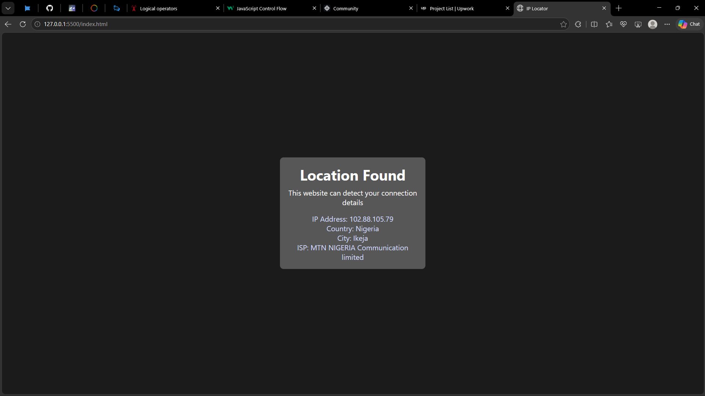

# IP Locator 🌍

A simple IP Locator application built with HTML, CSS, and JavaScript.

The application allows users to look up an IP address and retrieve available information about its geographical location and network details.

## Features

* Allows users to look up an IP address.
* Retrieves available location information associated with an IP address.
* Displays relevant IP address details dynamically on the webpage.
* Provides a simple and user-friendly interface.
* Helps users explore how IP address lookup works.

## Technologies Used

* HTML
* CSS
* JavaScript
* IP Geo-location API (if applicable)

## What I Learned

* How to work with user input in JavaScript.
* How to handle button clicks and user interactions.
* How to retrieve and display data dynamically.
* How to work with APIs and external data (if applicable).
* How to structure a simple web application using HTML, CSS, and JavaScript.
* How to debug and troubleshoot code.

## How It Works

1. The user enters an IP address.
2. The application processes the input.
3. The application retrieves the available information associated with the IP address.
4. The results are displayed on the webpage.

*The exact information returned depends on the geo-location service or API used by the application.*

## Preview

## How to Run

1. Clone this repository.
2. Open the project folder in Visual Studio Code.
3. Open `index.html` in your browser.
4. Enter an IP address and perform a lookup.

*If the application relies on an external API, an internet connection may be required.*

## Project Purpose

This project was built as part of my journey learning JavaScript and software development.

The goal was to practice working with user input, retrieving information, handling data, and displaying results through a functional web application.

## Disclaimer

IP geo-location provides an approximate location associated with an IP address. It does not reliably identify a person's exact physical location or street address.

## Author

**Efeose Isibor**

Learning, building, and improving one project at a time. 🚀
